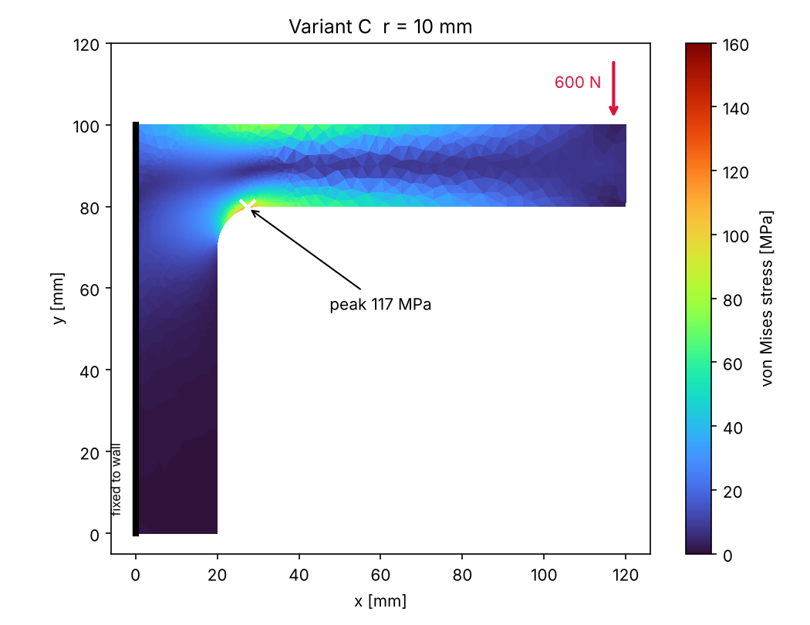
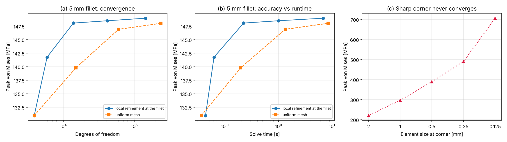
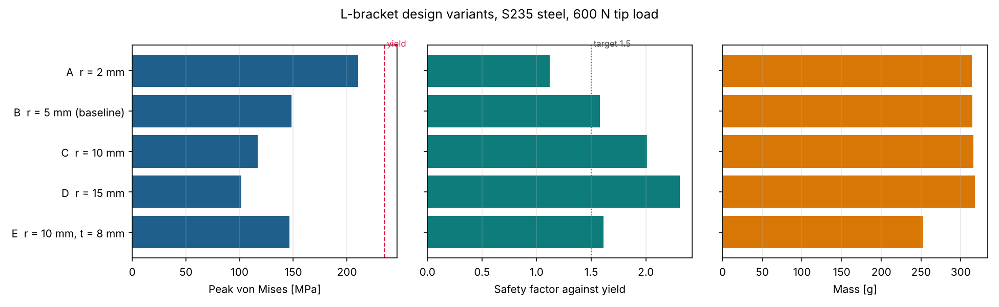

# L-Bracket Stress Optimisation with FEA

A finite element study of a steel wall bracket: where does it fail, how fine does the mesh need to be, and which design change gives the best balance of strength, stiffness and material use?

Built with **open-source tools** (Python, [scikit-fem](https://github.com/kinnala/scikit-fem), [Triangle](https://www.cs.cmu.edu/~quake/triangle.html)) so anyone can rerun it. A step-by-step guide for repeating the study in **ANSYS Mechanical** is in [`ansys/ANSYS_Student_steps.md`](ansys/ANSYS_Student_steps.md).



## Problem

| | |
|---|---|
| Geometry | L-bracket, 120 × 100 mm, 20 mm leg and arm, 10 mm plate thickness |
| Material | Structural steel S235: E = 210 GPa, ν = 0.30, yield strength 235 MPa |
| Supports | Vertical leg fixed to the wall (x = 0) |
| Load | 600 N downward at the free end of the arm |
| Model | 2D plane stress, quadratic (P2) triangular elements |
| Question | How does the radius of the inner fillet, and the plate thickness, affect peak stress, deflection, mass and safety factor? |

## Method

1. **Validate the solver** on a straight cantilever against beam theory (`scripts/01_validate_cantilever.py`).
2. **Mesh convergence** at the fillet, comparing local refinement with a uniform mesh (`scripts/02_mesh_convergence.py`).
3. **Design-variant study**: fillet radius 2, 5, 10 and 15 mm, plus a lighter 8 mm plate (`scripts/03_design_study.py`).

The peak von Mises stress is read in a zone around the inner corner. The clamped wall edge is an idealised boundary, so the small stress spikes at its corners are not used for design decisions.

## Results

### 1. Validation against beam theory

120 × 20 × 10 mm cantilever, 600 N tip load. Theory (Euler–Bernoulli + Timoshenko shear): tip deflection 0.2522 mm, bending stress at mid-span 54.0 MPa.

| Element size | Elements | Tip deflection | Error | σxx mid-span | Error |
|---|---|---|---|---|---|
| 4 mm | 544 | 0.2514 mm | −0.3 % | 53.65 MPa | −0.7 % |
| 1 mm | 8 817 | 0.2514 mm | −0.3 % | 53.91 MPa | −0.2 % |

The FE model matches beam theory within 0.3 %.

### 2. Mesh convergence



| Mesh at 5 mm fillet | DOFs | Peak von Mises | Solve time* |
|---|---|---|---|
| Local refinement, 0.5 mm at fillet | 41 688 | 148.5 MPa | ~1.0 s |
| Uniform 0.5 mm everywhere | 235 482 | 148.0 MPa | ~8 s |

Refining only where the stress gradient is high gives the same peak stress (within 0.5 %) with **about 82 % fewer degrees of freedom and about 85–90 % less solve time** than a uniform fine mesh. The 0.5 mm local mesh is used for the design study.

A **sharp corner (r = 0)** never converges: the peak stress keeps rising from 221 MPa to 706 MPa as the mesh is refined. This is a stress singularity, a modelling artefact. Real parts need a fillet, and the FE model needs one to give a meaningful stress.

\*Timings depend on the computer.

### 3. Design variants



| Variant | Peak von Mises | vs baseline | Tip deflection | Mass | Safety factor |
|---|---|---|---|---|---|
| A — r = 2 mm | 210.3 MPa | +41.6 % | 0.192 mm | 314 g | **1.12** |
| B — r = 5 mm (baseline) | 148.5 MPa | — | 0.185 mm | 314 g | 1.58 |
| C — r = 10 mm | 116.9 MPa | **−21.3 %** | 0.172 mm | 316 g | 2.01 |
| D — r = 15 mm | 101.7 MPa | −31.5 % | 0.159 mm | 318 g | 2.31 |
| E — r = 10 mm, t = 8 mm | 146.2 MPa | −1.6 % | 0.215 mm | **253 g (−19.7 %)** | 1.61 |

**Findings**

- The inner fillet controls the bracket's strength. Going from a 5 mm to a 10 mm fillet cuts the peak stress by 21 % and raises the safety factor from 1.58 to 2.01, for only 0.4 % more material.
- A 2 mm fillet leaves a safety factor of only 1.12 against yield, which is too low for a load-bearing part.
- **Recommended for a lightweight design: variant E.** With a 10 mm fillet, the plate can be thinned from 10 to 8 mm. That saves about 20 % of the material while keeping the peak stress and safety factor at the baseline level. The trade-off is 16 % more tip deflection (0.215 mm), which is acceptable for most bracket applications.
- **Recommended where stiffness matters: variant C.** It is 21 % lower in stress and 7 % stiffer, for practically the same mass.

**Sanity check.** The nominal bending stress in the arm at the corner is M·c/I = (600 N × 100 mm) × 10 mm / 6 667 mm⁴ = 90 MPa. The baseline peak of 148.5 MPa therefore implies a stress concentration factor of about 1.65 for r/d = 0.25. That is in the range expected for a shoulder fillet of this size.

## Limitations and next steps

- 2D plane stress. A 3D model would capture through-thickness effects and real bolt holes.
- Linear-elastic, static load only. A fatigue check (S–N curve, Goodman) would be needed for cyclic loading.
- An idealised fixed wall edge. Modelling the bolts and contact would give a more realistic support.
- Next: automate a finer parameter sweep and an optimisation loop (minimum mass subject to a safety factor ≥ 1.5).

## Run it yourself

```bash
pip install -r requirements.txt
python scripts/01_validate_cantilever.py
python scripts/02_mesh_convergence.py
python scripts/03_design_study.py
```

Results (CSV tables and plots) are written to `results/`.

## Project structure

```
src/bracket_fea.py               geometry, meshing, plane-stress FE solver, post-processing
scripts/01_validate_cantilever.py  solver check against beam theory
scripts/02_mesh_convergence.py     local vs uniform refinement, sharp-corner singularity
scripts/03_design_study.py         five design variants, plots and tables
ansys/ANSYS_Student_steps.md       how to repeat the study in ANSYS Mechanical
results/                           CSV tables and figures
```

---
Muhammad Maaz Asmat · Mechanical Engineer, M.Sc. student in Sustainable Maritime Operations (Hochschule Emden/Leer)
